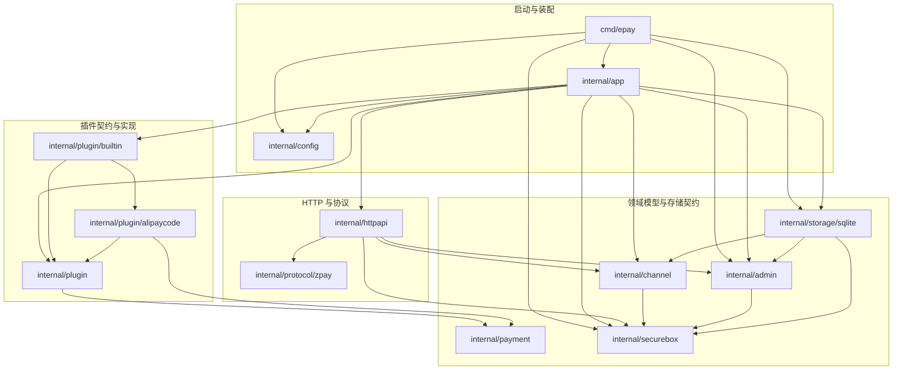
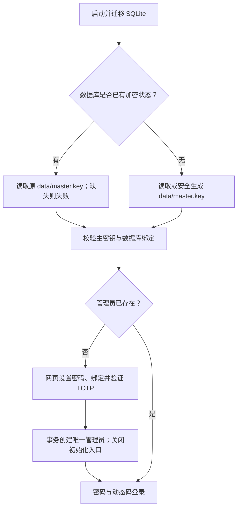
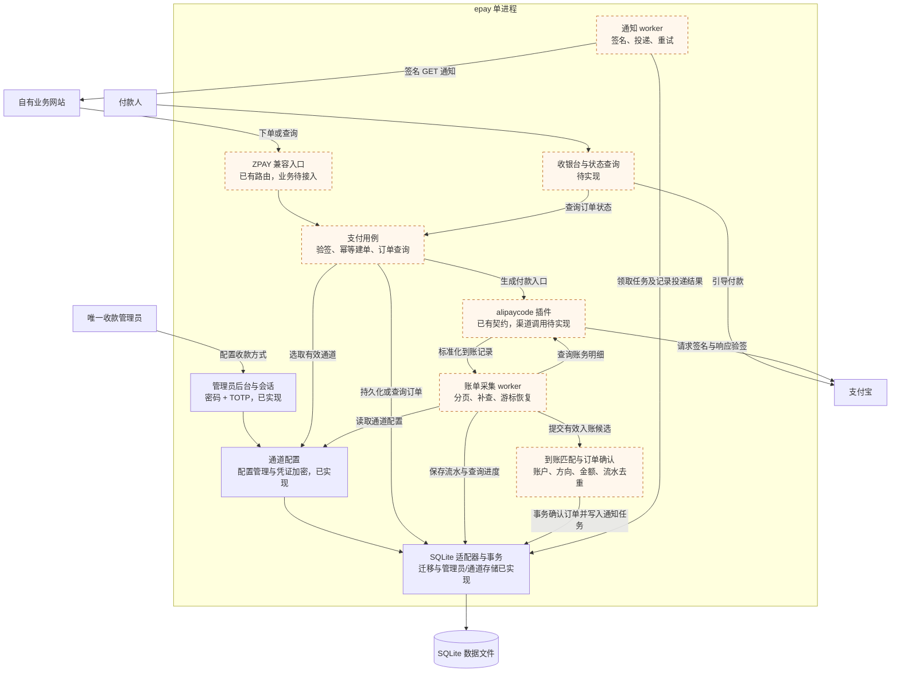

# 架构与数据流程

状态：第一步运行与管理员基础已接入，正在验收；支付业务按后续阶段推进。采用 Go 标准库 HTTP、单实例 SQLite 和可信编译式插件。

管理员服务的职责、安全规则与验证范围见 [管理员服务](admin.md)。

## 系统边界

只有一个收款管理员，可管理多个自己的收款通道。外部业务站点以 PID/key 调用兼容接口；第一版使用一套调用凭证，PID 保留为协议标识。不存在多租户、商户余额、结算、手续费或平台管理员。

## 包与依赖

```text
cmd/epay                         进程入口、信号、退出码
cmd/plugin-gen                   构建前插件发现与代码生成（仅构建工具）
internal/app                     组合根、依赖装配、生命周期
internal/config                  启动环境配置
internal/httpapi                 HTTP 路由、输入输出边界
internal/protocol/zpay           外部协议 DTO 与签名规范
internal/payment                 订单、金额、到账流水、原子存储契约
internal/channel                 收款账户与插件实例配置
internal/securebox               AES-GCM 用途隔离加密、主密钥文件
internal/admin                   单管理员密码、TOTP、会话与 CSRF 服务
internal/plugin                  插件契约、注册表
internal/plugin/builtin          自动生成的插件装配
internal/plugin/alipaycode       首个插件骨架
internal/storage/sqlite          SQLite 连接、版本迁移和存储适配器
```

### 当前包依赖图

箭头 `A → B` 表示 A 在 Go 源码中直接 import B，仅展示运行程序的项目内部依赖；cmd/plugin-gen 只使用标准库，是独立构建工具。当前 HTTP 层已接入管理员与通道服务，支付用例仍未接入。存储适配器实现领域包定义的接口，领域服务不依赖具体 SQLite 实现。



构建流程先扫描插件目录生成 builtin/registry_gen.go，再编译服务。app 仅依赖生成装配包；插件只依赖契约，不能反向依赖装配包。生成器不是运行时模块，不随服务启动执行。

目标依赖方向：HTTP → 用例/领域；插件和存储适配器 → 领域类型；app 装配具体实现。领域不导入 HTTP、SQL 或插件实现。用 Go 的结构体、方法和接口组合对象，不引入继承层次或服务定位器。

后续按真实功能引入 `internal/notification`（通知投递）与用例/worker 实现。`internal/admin` 提供双因素身份与会话；`internal/channel` 提供配置加密服务；管理员通道页面已接入。HTTP 中按协议路由、登录与表单、鉴权中间件、通道管理、模板分文件，SQLite 中按迁移、认证、通道、主密钥校验分文件。当前不为尚未实现的功能创建空包。

## 后台请求的登录检查

后台首页、通道管理和退出登录的处理函数使用 adminHandler 类型，显式接收 adminSession。Routes 注册这些接口时统一使用 requireLogin 包装；中间件调用 authenticate 检查会话和 CSRF Cookie，失败时结束请求，成功后才将会话交给业务处理函数。普通 HandleFunc 无法直接接收此类型，避免受保护函数漏包装后仍能编译。

保存通道和退出登录仍在处理函数中调用 parseForm 与 checkCSRF，检查来源及表单令牌。登录、首次初始化和健康检查使用各自的公开访问规则；支付占位接口保持明确失败。新增管理员接口须采用 adminHandler，不能将普通签名误当作自动受保护。

## 首次启动与初始化

config 仅加载非敏感运行配置。app 打开并迁移 SQLite，查询 RequiresKey，交给 securebox 从工作目录 data/master.key 加载主密钥；仅全新加密状态允许自动生成。密钥完整落盘后 VerifyKey 绑定数据库，最后装配身份服务与 HTTP。命令行仅保留 reset-totp 恢复功能，共用此密钥文件。



初始化 HTTP 边界复用同源检查与 CSRF；待绑定种子使用独立进程密钥加密 Cookie 保存，绑定十分钟有效期。初始化页通过同源图片入口在服务端生成标准 otpauth 绑定二维码，图片与手工密钥使用同一个 Cookie 中的种子，响应禁止缓存；创建成功后图片入口关闭。网页不回显主密钥，密码不进入 Cookie。管理员创建仍调用 admin.Initialize，SQLite 保证唯一性与审计原子写入。远程初始化不要求安装凭证，这是用户确认的部署选择；远程部署使用 HTTPS。

## 目标运行架构

下图表示计划中的调用与数据流，箭头不表示 Go 的 import 关系。虚线框模块尚未完成业务实现；管理员、加密配置和 SQLite 已可运行；支付相关方框仍属计划。付款人是外部支付参与者，不是系统新增的用户角色。



运行边界：HTTP 服务、采集任务和通知任务共享一个进程；插件是进程内的可信实现。数据库事务只覆盖本地持久化，支付宝查询和业务通知均在事务之外执行。图中的 worker 和用例是逻辑职责，具体分包随实现确定，不要求每个方框创建一个包。

## 计划中的下单流程

1. HTTP 层限制请求大小，从单一参数源读取值，拒绝重复参数和混用 GET/POST 的歧义。
2. 兼容层按原始解析值验签，再进行业务规范化。校验固定 PID、金额、订单号、类型和预登记回调地址。
3. 首先按 `(pid, out_trade_no)` 查询已有订单。同一业务请求返回原单；金额、名称、回调或其他重要字段冲突时拒绝，不能静默覆盖。
4. 只从已启用且支持请求支付类型的通道中选择。`cid` 限定候选集；未指定时从该类型的有效通道中随机选择。
5. 持久化订单后调用插件生成付款动作。再次下单可继续原单，不能另建收款义务。
6. `/submit.php` 跳转至本系统收银台；`/mapi.php` 输出协议 DTO。插件返回结构化动作，收银台模板由核心渲染。

金额从输入直接解析为整数分，禁止经过 float64。时间持久化为 UTC，兼容 API 的时间展示使用 Asia/Shanghai。

## 到账采集与确认

- 核心调度每个已启用通道的采集任务，同一通道只允许一个有效采集租约/任务。
- 插件查询固定时间窗口、完整分页并验证渠道响应签名；返回标准化到账记录。
- 核心检查渠道来源、账户、收支方向、有效状态、金额和订单标识。
- 先落库新流水与检查点，再推进游标。采用重叠窗口和唯一约束去重，进程重启可补查；有未支付订单才查最近三分钟的旧逻辑不沿用。
- 确认支付时，在同一事务内关联唯一流水、将 `pending` 改为 `paid`、创建唯一通知任务。重复确认是无副作用操作，冲突进入异常处理。
- 已关闭或过期订单的到账保留为异常，不静默丢弃、不直接自动发货。后续增加人工确认，并记录审计依据。
- 网络请求在数据库事务之外执行。SQLite 使用 WAL、busy timeout 和短事务；多实例部署暂不支持。

## 通知与前台跳转

通知任务采用持久化 outbox：支付事务写入任务，worker 在提交后签名发送 GET 请求。超时按协议重试；中断后恢复过期租约。对端可能收到多次通知，必须按订单号幂等处理。

前台仅查询本系统状态。`return_url` 是浏览器完成后的导航，不作为支付证明，也不影响异步通知结果。

## 数据与迁移

`internal/storage/sqlite/migrations/*.sql` 是唯一可执行结构定义，使用 embed 随程序发布。迁移逐版本事务提交，应用记录写入 schema_migrations；重启不重复执行，未知版本拒绝启动。已包含 owner、admin_sessions、admin_login_attempts、channels、security_state、audit_events，以及后续支付表。核心约束：

- `owner.id = 1`：唯一管理员。
- `UNIQUE(pid, out_trade_no)`：业务订单幂等。
- `UNIQUE(provider_id, account_id, transaction_id)`：跨通道配置的到账去重。
- `receipts.matched_trade_no UNIQUE`：首版一笔到账对应一张订单。
- `notification_jobs.trade_no UNIQUE`：支付事件只创建一项通知任务。

0002 迁移为已有管理员增加 TOTP 字段并撤销历史单因素会话；旧记录未绑定 TOTP 时无法登录，须本地 reset-totp 完成绑定。支付表当前只有结构，没有相应业务用例。迁移脚本发布后不改写，使用新增版本推进；当前无自动回滚或多实例迁移协调。

身份认证先执行持久化限流，再验证密码、解密 TOTP 种子并校验动态码；条件更新 last_totp_step 与会话创建在同一事务内，保证并发请求最多一个成功。重置种子与撤销所有会话原子提交。

通道 JSON 通过 Vault 校验并加密，仓储仅接触密文。列表和编辑页只读取元数据；留空更新在 SQL 中保留密文，不做“读旧值再覆盖”的更新。主密钥校验值在启动时验证，防止错误密钥静默运行。安全事件只记录操作类型、对象 ID 与时间，不记录凭证。

## 实施顺序

1. 当前第一步：SQLite、单管理员初始化、密码与 TOTP 登录、会话、配置加密与最小后台；完成后等待确认。
2. ZPAY 验签、订单幂等、`/submit.php`、`/mapi.php` 和 `act=order`；余额和退款继续明确失败。
3. alipaycode 付款入口、账单轮询、流水去重及原子确认。
4. 通知持久化重试、收银台状态页、异常到账与恢复验证。

遇到决策疑问立即停止提问；每步交付审核后才开始下一步。

不再研究支付宝应用能否开通；按用户已确认可用的前提开发。真实账户联调只在业务实现阶段按授权进行。
