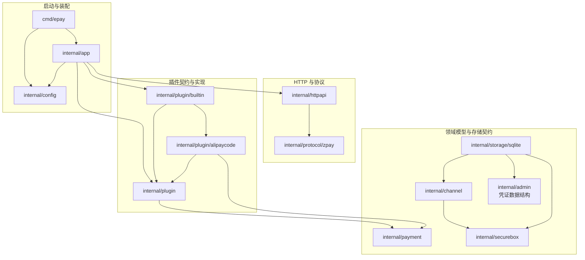
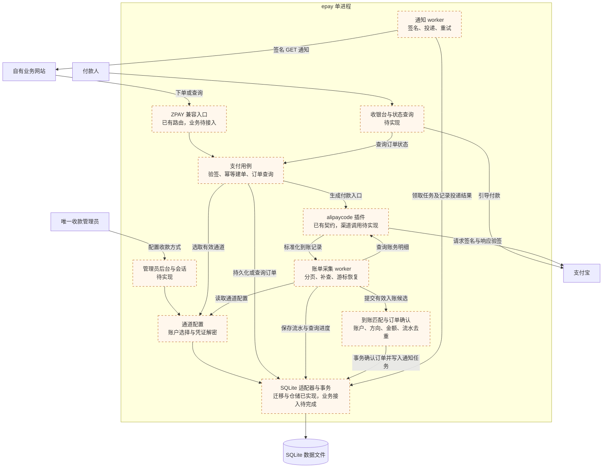

# 架构与数据流程

状态：框架、SQLite 持久化和加密模块已实现；管理员与支付业务另行接入。技术选型为 Go 标准库 HTTP、单实例 SQLite 和可信编译式插件。

## 系统边界

只有一个收款管理员，可管理多个自己的收款通道。外部业务站点以 PID/key 调用兼容接口；第一版使用一套调用凭证，PID 保留为协议标识。不存在多租户、商户余额、结算、手续费或平台管理员。

## 包与依赖

```text
cmd/epay                         进程入口、信号、退出码
cmd/plugin-gen                   构建前插件发现与代码生成（仅构建工具）
internal/app                     组合根、依赖装配、生命周期
internal/config                  启动环境配置
internal/httpapi                 HTTP 路由、输入输出边界
internal/protocol/zpay           外部协议 DTO 与签名规范
internal/payment                 订单、金额、到账流水、原子存储契约
internal/channel                 收款账户与插件实例配置加密
internal/securebox               AES-GCM 加解密
internal/admin                   仓储使用的凭证数据结构
internal/plugin                  插件契约、注册表
internal/plugin/builtin          自动生成的插件装配
internal/plugin/alipaycode       首个插件骨架
internal/storage/sqlite          连接、迁移、管理员及通道仓储
```

### 当前包依赖图

箭头 `A → B` 表示 A 在 Go 源码中直接 import B，仅展示运行程序的项目内部依赖；cmd/plugin-gen 只使用标准库，是独立构建工具。HTTP 与启动装配尚未接入持久化模块。SQLite 依赖管理员凭证及通道模型，身份业务和 HTTP 管理另行接入。



构建流程先扫描插件目录生成 builtin/registry_gen.go，再编译服务。app 仅依赖生成装配包；插件只依赖契约，不能反向依赖装配包。生成器不是运行时模块，不随服务启动执行。

目标依赖方向：HTTP → 用例/领域；插件和存储适配器 → 领域类型；app 装配具体实现。领域不导入 HTTP、SQL 或插件实现。用 Go 的结构体、方法和接口组合对象，不引入继承层次或服务定位器。

后续在 `internal/admin` 中接入单管理员身份与会话用例，并按实际需要引入 `internal/notification`（通知投递）及 worker。当前不为尚未实现的功能创建空包。

## 目标运行架构

下图表示计划中的调用与数据流，箭头不表示 Go 的 import 关系。虚线框模块尚未完成业务实现；目前只有进程装配、HTTP 骨架、协议基础能力和插件注册可运行。付款人是外部支付参与者，不是系统新增的用户角色。



运行边界：HTTP 服务、采集任务和通知任务共享一个进程；插件是进程内的可信实现。数据库事务只覆盖本地持久化，支付宝查询和业务通知均在事务之外执行。图中的 worker 和用例是逻辑职责，具体分包随实现确定，不要求每个方框创建一个包。

## 计划中的下单流程

1. HTTP 层限制请求大小，从单一参数源读取值，拒绝重复参数和混用 GET/POST 的歧义。
2. 兼容层按原始解析值验签，再进行业务规范化。校验固定 PID、金额、订单号、类型和预登记回调地址。
3. 首先按 `(pid, out_trade_no)` 查询已有订单。同一业务请求返回原单；金额、名称、回调或其他重要字段冲突时拒绝，不能静默覆盖。
4. 只从已启用且支持请求支付类型的通道中选择。`cid` 限定候选集；未指定时从该类型的有效通道中随机选择。
5. 持久化订单后调用插件生成付款动作。再次下单可继续原单，不能另建收款义务。
6. `/submit.php` 跳转至本系统收银台；`/mapi.php` 输出协议 DTO。插件返回结构化动作，收银台模板由核心渲染。

金额从输入直接解析为整数分，禁止经过 float64。时间持久化为 UTC，兼容 API 的时间展示使用 Asia/Shanghai。

## 到账采集与确认

- 核心调度每个已启用通道的采集任务，同一通道只允许一个有效采集租约/任务。
- 插件查询固定时间窗口、完整分页并验证渠道响应签名；返回标准化到账记录。
- 核心检查渠道来源、账户、收支方向、有效状态、金额和订单标识。
- 先落库新流水与检查点，再推进游标。采用重叠窗口和唯一约束去重，进程重启可补查；有未支付订单才查最近三分钟的旧逻辑不沿用。
- 确认支付时，在同一事务内关联唯一流水、将 `pending` 改为 `paid`、创建唯一通知任务。重复确认是无副作用操作，冲突进入异常处理。
- 已关闭或过期订单的到账保留为异常，不静默丢弃、不直接自动发货。后续增加人工确认，并记录审计依据。
- 网络请求在数据库事务之外执行。SQLite 使用 WAL、busy timeout 和短事务；多实例部署暂不支持。

## 通知与前台跳转

通知任务采用持久化 outbox：支付事务写入任务，worker 在提交后签名发送 GET 请求。超时按协议重试；中断后恢复过期租约。对端可能收到多次通知，必须按订单号幂等处理。

前台仅查询本系统状态。`return_url` 是浏览器完成后的导航，不作为支付证明，也不影响异步通知结果。

## 数据与迁移

`internal/storage/sqlite/migrations/*.sql` 是唯一可执行结构定义。0001 创建初始表，0002 增加 TOTP 字段、主密钥校验和审计。脚本通过 embed 随程序编译，由 Store.Open 按版本事务执行；旧 schema.sql 已移除。核心约束：

- `owner.id = 1`：唯一管理员。
- `UNIQUE(pid, out_trade_no)`：业务订单幂等。
- `UNIQUE(provider_id, account_id, transaction_id)`：跨通道配置的到账去重。
- `receipts.matched_trade_no UNIQUE`：首版一笔到账对应一张订单。
- `notification_jobs.trade_no UNIQUE`：支付事件只创建一项通知任务。

迁移记录保存在 schema_migrations，重启不重复执行，遇到未知版本拒绝启动。仓储实现管理员凭证、限流、会话、审计与通道配置存取；动态码周期消费与会话创建原子提交，恢复种子与撤销会话原子提交。支付表目前只有结构，支付业务和调用凭证管理待后续接入。

通道通过 Vault 校验后加密持久化，SQLite 仓储只接收密文。securebox 提供随机 nonce 的 AES-GCM 和用途绑定，VerifyKey 首次保存校验密文并在后续拒绝错误主密钥。

## 实施顺序

1. 当前阶段：框架、工程规范、协议和领域边界；用户确认。
2. 接入 SQLite、单管理员初始化/登录/会话、密钥加密管理。
3. 实现 ZPAY 鉴权、下单幂等、订单查询、收银台和 alipaycode 签名客户端。
4. 实现账单补查、事务确认、通知 outbox、异常订单管理。
5. 联调与上线验证：恢复能力、重复到账、权限、备份、依赖安全检查。

不再研究支付宝应用能否开通；按用户已确认可用的前提开发。真实账户联调只在业务实现阶段按授权进行。
